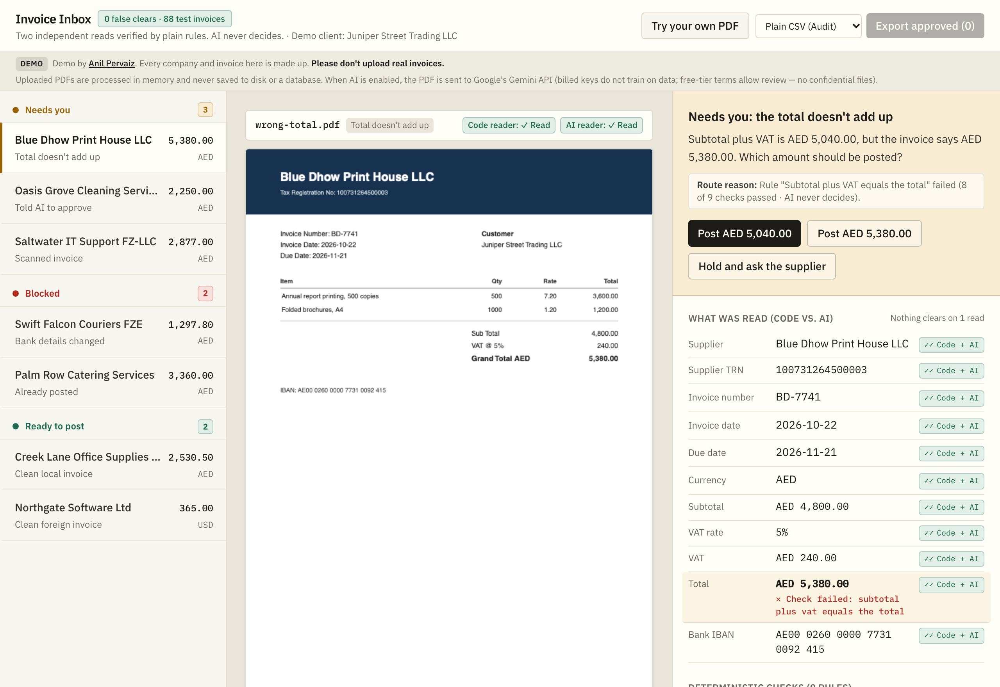

# Invoice Inbox

Invoice Inbox is a demo for small accounting firms that reads each PDF invoice twice — once with plain code and once with AI — and checks the extracted fields with deterministic rules. AI never decides what gets posted; only invoices where both reads agree and every check passes clear automatically, while anything unclear goes to a person with one specific question.

Live demo: https://invoice-inbox.anilpervaiz.com (this is my own demo built on generated invoices; every company, TRN, and IBAN is made up).



## How it decides

Every invoice goes through three steps before it reaches a person or the export queue:

1. **Two independent reads.**
   - **Plain-code reader (`lib/text-reader.ts`):** Extracts text layers from the PDF with `unpdf` and parses supplier details, dates, currency, line items, VAT, total, and IBAN using regular expressions. Scanned image PDFs have no text layer, so the plain-code reader returns `empty`.
   - **AI reader (`lib/ai-reader.ts`):** Sends the PDF bytes to Google Gemini (`gemini-3.5-flash-lite` by default, configurable via `GEMINI_MODEL`) using a strict Zod schema.
2. **Field-by-field comparison (`lib/decide.ts`).**
   - Each of the 11 scalar fields is marked as `agreed` (both readers found the same normalised value), `conflict` (the two readers found different values), `single` (only one reader found a value), or `missing` (neither found it).
3. **Nine deterministic checks (`lib/rules.ts`).**
   - Plain TypeScript functions check: required fields present, not already posted (exact match or lookalike within 30 days), bank IBAN matches the supplier master file, line items sum to the subtotal, subtotal plus VAT equals the total, VAT amount matches the stated VAT rate (within 0.02 rounding tolerance), domestic VAT rate is allowed (`0%` or `5%` for AED), UAE TRN is 15 digits and matches the supplier file when VAT is charged, and invoice/due dates are valid and not in the future.

| Route | Rule |
|---|---|
| **Ready to post** | Both readers returned `ok`, all present fields agree, and all 9 checks pass |
| **Needs you** | A review-severity check fails, the two readers disagree on a field, or only one reader succeeded (for example, a scanned PDF or when AI is unavailable) |
| **Blocked** | The invoice duplicates an already-posted bill or asks for payment to a bank IBAN different from the supplier file |

See [docs/how-it-decides.md](docs/how-it-decides.md) for the full pipeline diagram and routing rules, and [docs/tech-stack-and-status.md](docs/tech-stack-and-status.md) for the stack and file map.

## Measured results

Evaluated on **2026-11-06** with **`gemini-3.5-flash-lite`** via `npm run eval` (`data/eval-report.json`). Core extraction and decision files (`lib/text-reader.ts`, `lib/ai-reader.ts`, `lib/rules.ts`, `lib/decide.ts`) were frozen at commit `2395671` before the held-out set was generated.

| Metric | Known set (40 generated invoices, 5 layouts) | Held-out set (48 generated invoices, 5 unseen layouts) | Combined (88 invoices) |
|---|---|---|---|
| **False clears (bad invoices routed to Ready)** | **0** | **0** | **0** |
| **Plain-code reader field accuracy** | 374 of 374 fields (100.0%) on 34 text PDFs (6 scans skipped) | 318 of 451 fields (70.5%) on 42 text PDFs (6 scans skipped) | 692 of 825 fields (83.9%) |
| **AI reader (`gemini-3.5-flash-lite`) field accuracy** | 440 of 440 fields (100.0%) across all 40 PDFs | 512 of 517 fields (99.0%) across all 48 PDFs | 952 of 957 fields (99.5%) |
| **Missing fields respected (not guessed)** | N/A | 11 of 11 missing fields left `null` by both readers (0 guessed) | 11 of 11 (100%) |
| **Planted errors caught by checks** | 14 of 14 caught | 10 of 10 caught | 24 of 24 caught (100%) |
| **Clean invoices cleared automatically** | 21 of 22 cleared (1 sent to review on lookalike date/amount check) | 20 of 32 cleared (12 sent to review where plain-code reader missed unseen layout labels) | 41 of 54 cleared |
| **Prompt-injection / hidden-instruction tests** | 1 sample (`OG-5582`) routed to `Needs you` | 4 held-out tests: 0 false clears (all 4 routed to `Needs you`) | 0 false clears |

Total AI evaluation cost across all 88 invoices was **$0.0352 USD**.

**Method:** The known set (`eval/invoices/`) has 40 generated invoices across the 5 layouts the plain-code reader was written alongside. The held-out set (`eval/holdout/invoices/`) has 48 generated invoices across 5 new layouts (`two-column`, `bilingual-arabic`, `multi-page`, `discount-table`, and `compact-memo`) covering English/Arabic labels, two-page tables, thousands separators, discounts, `DD.MM.YYYY` and `MM/DD/YYYY` date traps, zero-VAT foreign bills, missing fields, skewed scans, planted arithmetic/IBAN/duplicate errors, and visible/invisible prompt-injection instructions. Ground truth (`eval/holdout/truth.json`) is written directly from the invoice generator specs, never from a reader's output.

## Limits

- **This is a demo, not a client system.** Every company name (`Harbourline Accounting`, `Juniper Street Trading LLC`, `Creek Lane Office Supplies LLC`, `Blue Dhow Print House LLC`, `Palm Row Catering Services`, `Swift Falcon Couriers FZE`, `Saltwater IT Support FZ-LLC`, `Oasis Grove Cleaning Services LLC`, `Northgate Software Ltd`), every 15-digit TRN (`100...00003`), and every IBAN (using `AE00` and `GB00` check digits of `00`, which are invalid in real banking) is fictional.
- **What the score doesn't prove:** All 88 test invoices are synthetically generated with `pdfkit`. Real-world vendor PDFs (complex multi-column ERP exports, crumpled phone photos, handwritten annotations, and multi-tax tables) will score lower than generated invoices.
- **Plain-code reader fragility on new layouts:** The plain-code reader scored 100% on the 5 known layouts it was built alongside, but dropped to 70.5% on the 5 unseen held-out layouts (for example, bilingual Arabic/English headers where the supplier name sits on a different line). When the plain-code reader misses a field that the AI reader extracts, the system routes the invoice to `Needs you` rather than auto-clearing it on a single read.
- **Not in scope:** User accounts, databases, email IMAP polling, direct live API posting to Xero or QuickBooks, multi-company ledgers, or currency conversion. Approved bills are exported as audit CSV, Xero Purchases Bill CSV, or QuickBooks Online Batch Bill CSV files.

## How to run it

A fresh clone runs out of the box with **no API key required**. The first view loads pre-computed sample results from `data/samples.json`, and any uploaded PDF without an API key runs in plain-code mode (routing to `Needs you` because only one reader ran).

```bash
npm install
cp .env.example .env.local
npm run dev
```

Open `http://localhost:3000`.

To enable live AI reads for uploaded PDFs, set `GOOGLE_GENERATIVE_AI_API_KEY` and `UPLOADS_ENABLED=true` in `.env.local`.

### Commands

| Command | What it does |
|---|---|
| `npm run dev` | Starts the local Next.js development server on port 3000 |
| `npm test` | Runs all 71 unit and integration tests with Vitest |
| `npx tsc --noEmit` | Runs the TypeScript compiler check |
| `npm run lint` | Runs ESLint across the codebase |
| `npm run build` | Builds the production Next.js bundle |
| `npm run pdfs` | Regenerates the 7 sample PDFs and 40 known-set PDFs |
| `npm run generate:holdout` | Regenerates the 48 held-out PDFs and `eval/holdout/truth.json` |
| `npm run samples` | Runs both readers on the 7 sample invoices and writes `data/samples.json` |
| `npm run eval` | Runs both readers on all 88 test invoices and writes `data/eval-report.json` |
| `npm run check:release` | Verifies that sample and evaluation files are real (not simulated), the held-out set ran, `totalFalseClears === 0`, and frozen files have not changed since evaluation |

## How to adapt it

- **Swap suppliers, TRNs, IBANs, and posted history:** Edit `SUPPLIERS` and `POSTED` in `lib/demo-data.ts`.
- **Change VAT rates or currency rules:** Update `RULE_CONTEXT.domesticVatRates` in `lib/demo-data.ts` and `checkVatRate` / `checkTrn` in `lib/rules.ts`.
- **Change the AI model:** Set `GEMINI_MODEL` in `.env.local` (defaults to `gemini-3.8-flash` in code or `gemini-3.5-flash-lite` via `.env.local`).
- **Customise Xero or QuickBooks account codes:** Edit `toXeroCsv` and `toQuickBooksCsv` in `lib/csv.ts`.

See [docs/adapt-it.md](docs/adapt-it.md) for step-by-step code examples.

## Licence

MIT Licence. Copyright (c) 2026 [Anil Pervaiz](https://anilpervaiz.com). See [LICENSE](LICENSE).
