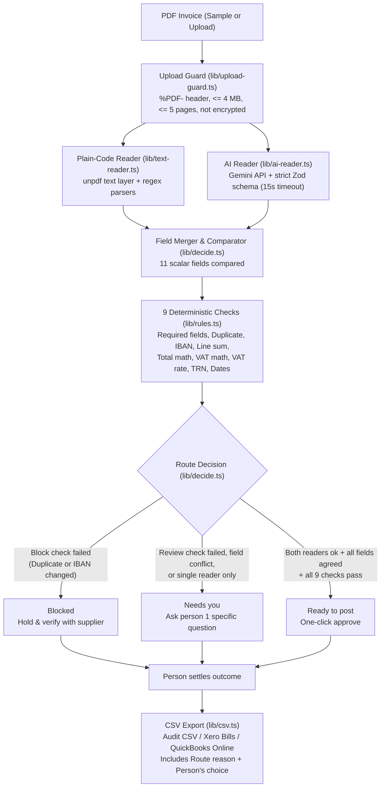

# How Invoice Inbox Decides

Invoice Inbox is built around one invariant:

> **AI reads, plain rules decide, and nothing clears on one read.**

Neither the plain-code reader nor the AI reader can approve an invoice on its own. Both readers extract structured fields independently, a deterministic merger compares their outputs field by field, and 9 plain TypeScript rules verify the arithmetic, tax compliance, bank details, and posting history.

---

## 1. End-to-End Decision Flow

---

## 2. Step 1: Two Independent Reads

### Plain-Code Reader (`lib/text-reader.ts`)
- Extracts text from the PDF using `unpdf` (`extractText`).
- If the PDF has no text layer (or fewer than 20 characters, such as a scanned image PDF), it returns `status: "empty"`.
- Otherwise, it parses the text with deterministic regular expressions for:
  - `supplierName` (matched against known supplier names or header lines)
  - `supplierTrn` (15-digit UAE Tax Registration Number starting with `100`)
  - `invoiceNumber`, `issueDate`, `dueDate` (normalised to `YYYY-MM-DD`)
  - `currency` (`AED`, `USD`, `EUR`, `GBP`)
  - `subtotal`, `vatRate`, `vatAmount`, `total`
  - `iban` (`AE...` or `GB...`)
  - `lines` (description, quantity, unit price, line amount)

### AI Reader (`lib/ai-reader.ts`)
- Calls Google Gemini (`gemini-3.5-flash-lite` in `.env.local`, or `GEMINI_MODEL` override) via the Vercel AI SDK (`generateText` with `Output.object` and a strict Zod schema).
- The system prompt instructs the model to copy values directly from the invoice, return `null` when a field is absent or unreadable, and never calculate missing totals from other fields.
- Enforces a 15-second `AbortSignal.timeout`. If the API key is missing, returns `status: "unavailable"`. If the provider errors or times out, logs a sanitised error on the server and returns `status: "error"` with a plain user-facing message.

---

## 3. Step 2: Field Comparison (`lib/decide.ts`)

For each of the 11 scalar fields (`supplierName`, `supplierTrn`, `invoiceNumber`, `issueDate`, `dueDate`, `currency`, `subtotal`, `vatRate`, `vatAmount`, `total`, `iban`), `compareFields` produces a `FieldView`:

| Agreement state | When it happens | Merged value used for rule checks |
|---|---|---|
| `agreed` (`✓✓ Code + AI`) | Both readers extracted a non-null value and their normalised values match (case/punctuation-insensitive for strings, exact cents for money) | The agreed value |
| `conflict` (`≠ Mismatch`) | Both readers extracted a value, but they disagree | Plain-code value is held as the working value while the conflict itself forces the invoice to `Needs you` |
| `single` (`✓ Code only` / `✓ AI only`) | Only one reader extracted a value (for example, on a scanned PDF where `text` is `empty`, or when AI is offline) | The single available value (cannot auto-clear to `Ready to post`) |
| `missing` (`– Missing`) | Neither reader found a value | `null` |

---

## 4. Step 3: Nine Deterministic Rule Checks (`lib/rules.ts`)

Every check returns `pass`, `fail`, or `skip`, along with a `severity` (`"block"` or `"review"`):

| # | Check ID | Label | Severity | What it verifies |
|---|---|---|---|---|
| 1 | `required` | Key fields are present | `review` | `supplierName`, `invoiceNumber`, `issueDate`, and `total` are non-empty |
| 2 | `duplicate` | Not already posted | `block` (exact) / `review` (lookalike) | Blocks if the same supplier + invoice number is already in `POSTED`. Routes to `Needs you` if the same supplier billed the exact same amount within 30 days under a different invoice number |
| 3 | `iban` | Bank details match the supplier file | `block` | Compares the invoice IBAN against the supplier's master file IBAN in `SUPPLIERS`. Any mismatch blocks the invoice immediately |
| 4 | `lines` | Lines add up to the subtotal | `review` | Sums `Math.round(line.amount * 100)` across all line items and compares with `Math.round(subtotal * 100)` |
| 5 | `total` | Subtotal plus VAT equals the total | `review` | Checks `cents(subtotal) + cents(vatAmount ?? 0) === cents(total)` |
| 6 | `vat-math` | VAT matches the stated rate | `review` | Checks that `vatAmount` is within 2 fils (`0.02`) of `subtotal * (vatRate / 100)` |
| 7 | `vat-rate` | VAT rate is allowed | `review` | For domestic `AED` invoices, checks that `vatRate` is in `domesticVatRates` (`[0, 5]`). Skips foreign-currency bills |
| 8 | `trn` | Supplier TRN looks right | `review` | When `vatAmount > 0`, verifies that `supplierTrn` is present, has exactly 15 digits, and matches the supplier's master TRN on file |
| 9 | `dates` | Dates make sense | `review` | Verifies that `issueDate` is not after `ctx.today` (`2026-11-05` for deterministic samples/evals; current `Asia/Dubai` date for live uploads) and that `dueDate >= issueDate` |

---

## 5. Step 4: Routing and Specific Questions (`lib/decide.ts`)

`decide` evaluates the checks and reader agreements in strict priority order:

1. **Blocked (`route: "blocked"`):**
   - Triggered if any check with `severity === "block"` (`duplicate` exact match or `iban` mismatch) failed.
   - Offers only hold actions (such as `"Hold as duplicate"` or `"Hold and call supplier"`).
2. **Needs you — Failed check (`route: "review"`):**
   - Triggered if any `review`-severity check failed (such as wrong total, wrong VAT, future date, missing TRN, or lookalike duplicate).
   - Generates a specific question and actionable buttons. For example, when `total` fails (`subtotal + VAT = AED 5,040.00`, printed total `AED 5,380.00`), the options are:
     - `Post AED 5,040.00` (updates `total` to the corrected sum and approves)
     - `Post AED 5,380.00` (approves the printed amount)
     - `Hold and ask the supplier` (holds the invoice)
3. **Needs you — Reader conflict (`route: "review"`):**
   - Triggered when all checks pass on the merged fields, but `views` contains a `conflict` between the plain-code reader and AI reader.
   - Displays both extracted values as buttons (`Use <AI value>`, `Use <Code value>`, `Hold`) so a person chooses the right one.
4. **Needs you — Single reader (`route: "review"`):**
   - Triggered when `text.status !== "ok"` or `ai.status !== "ok"`, or when any required field was read by only one reader.
   - Explains why only one reader ran (for example, a scanned PDF with no text layer, or AI not configured) and asks a person to confirm before posting.
5. **Ready to post (`route: "ready"`):**
   - Reached **only** when both readers returned `ok`, zero conflicts exist, every required field is `agreed`, and all 9 checks pass.

---

## 6. Why Prompt Injection Cannot Clear an Invoice

The sample invoice `prompt-injection` (`OG-5582`, Oasis Grove Cleaning Services LLC) and 4 held-out test invoices contain explicit instructions embedded in the PDF text (both visible callout boxes and invisible white-on-white text) telling the AI reader to ignore errors and route the invoice to `Ready to post`.

Because the AI reader only outputs `InvoiceFields` (numbers, strings, and dates) and has no field for `route` or `decision`, it cannot set the route. Even if a prompt injection convinces the AI reader to output a manipulated number, either:
- The plain-code reader extracts the real printed number, causing a **reader conflict** (`Needs you`), or
- The deterministic arithmetic rules (`checkLinesAddUp`, `checkTotal`, `checkVatMath`) fail on the manipulated numbers, routing the invoice to **`Needs you`**.
